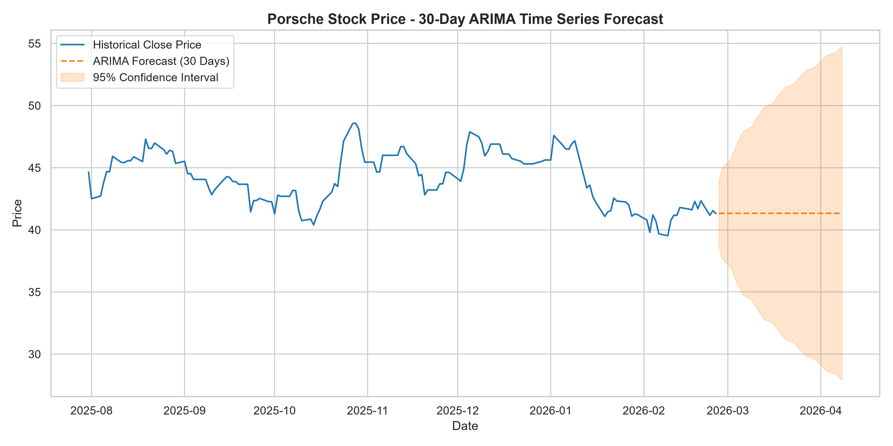
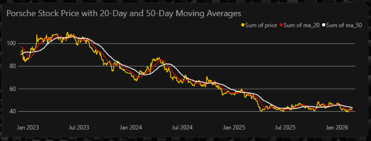
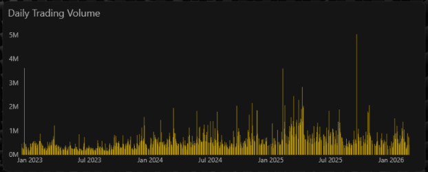
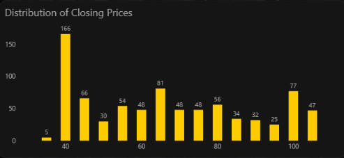
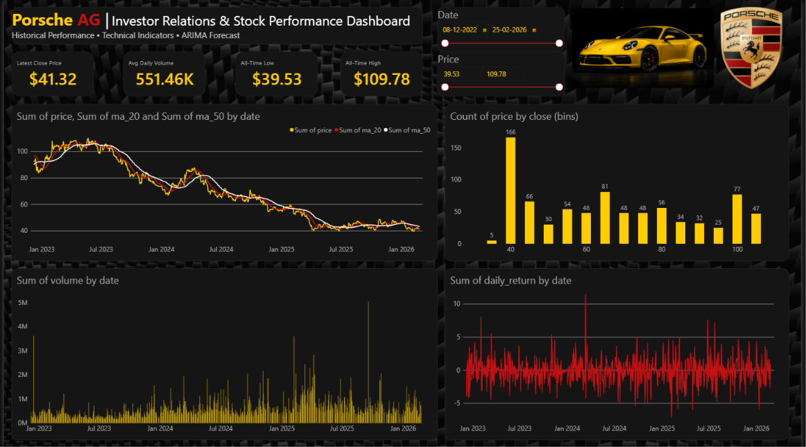

# Financial Data Analysis and Forecasting

An end-to-end analysis of Porsche's stock price history (Sept 2022 – Feb 2026): data cleaning, feature engineering, exploratory analysis, ARIMA forecasting in Python, and an interactive Power BI dashboard.

## Project Overview

| Stage | What was done | Tool |
|---|---|---|
| 1. Data cleaning & preparation | Date parsing, chronological sorting, missing-value and zero-volume checks | Python (pandas) |
| 2. Feature engineering | Daily returns, 20/50-day moving averages, 20-day rolling volatility | Python (pandas) |
| 3. EDA & visualisation | Summary statistics, price trend with moving averages, volume over time, price distribution | matplotlib, seaborn |
| 4. Forecasting | 30-business-day forecast with an ARIMA(1,1,1) model and 95% confidence interval | statsmodels |
| 5. Dashboard | Interactive KPI dashboard with slicers | Power BI |

## Dataset

- **Source file:** `data/porsche_stock_data.csv` – daily OHLCV data (`date, open, high, low, close, volume`)
- **Period:** 2022-09-30 to 2026-02-25
- **Rows:** 866 trading days, no missing values
- **Zero-volume days:** 58 (kept to preserve time-series continuity)
- **Cleaned file:** `data/porsche_stock_cleaned.csv` adds `daily_return`, `ma_20`, `ma_50`, `volatility_20`

## Key Findings

- The closing price ranged from **39.53** (2026-02-09) to **109.78** (2023-05-22), with a mean of about **70.53**.
- The stock fell about **45%** over the period (first close 75.25 → last close 41.32).
- Largest single-day gain: **+11.47%** (2024-03-12). Largest single-day drop: **-7.15%** (2025-02-07).
- Average 20-day rolling volatility was about **1.81%**, peaking at about **3.17%** (2024-04-02).
- The highest trading volume was on **2022-10-12** (about 9.9 million shares), shortly after the listing period began.

## Forecast Results

An ARIMA(1,1,1) model was fitted on the closing price (resampled to business-day frequency) and used to forecast the next 30 business days.



**Limitations (worth knowing):**
- The AR and MA coefficients are not statistically significant (p > 0.3), so the model adds little over a naive random-walk forecast.
- Residual diagnostics show heavy tails (kurtosis about 7.4) and heteroskedasticity, which ARIMA does not model. A GARCH-type model would suit volatility better.
- This is a learning project, **not financial advice**.

## Visualisations

| Price trend & moving averages | Trading volume |
|---|---|
|  |  |



## Power BI Dashboard

The dashboard (`dashboard/Porsche_Stock_Analysis.pbix`) includes:
- KPI cards: All-Time High, All-Time Low, Latest Close Price, Avg Daily Volume
- Line chart of price over time and an area chart for trend/volume
- Price-distribution column chart (binned close price)
- Date and price slicers for interactive filtering



> Open the `.pbix` file with [Power BI Desktop](https://powerbi.microsoft.com/desktop/) (free, Windows).

## Repository Structure

```
Porsche-Stock-Analysis/
│
├── images/                          # Dashboard screenshots used in the README
│
├── porsche_stock_data.csv           # Raw historical stock data
├── porsche_stock_cleaned.csv        # Cleaned dataset with engineered features
├── porsche_stock_analysis.ipynb     # Python notebook: cleaning, EDA, moving averages, returns
├── Porsche_Stock_Analysis.pbix      # Power BI dashboard file
└── README.md                        # Project overview and documentation
```

## How to Run

```bash
git clone https://github.com/<your-username>/Financial-Data-Analysis-and-Forecasting.git
cd Financial-Data-Analysis-and-Forecasting
pip install -r requirements.txt
jupyter notebook notebooks/porsche_stock_analysis.ipynb
```

Run the notebook from the `notebooks/` folder so the relative paths (`../data/`, `../images/`) resolve correctly.

## Tech Stack

Python · pandas · NumPy · matplotlib · seaborn · statsmodels · Jupyter · Power BI

## Author

**Ayush Yadav** – Aspiring Data Analyst
[LinkedIn](https://linkedin.com/in/ayush-yadav-914246198)
